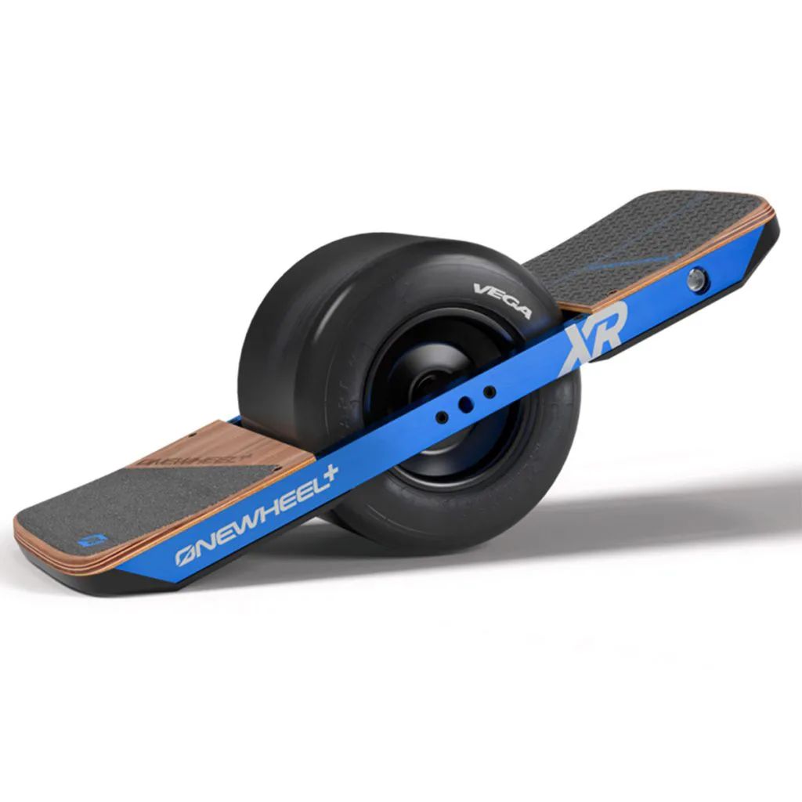
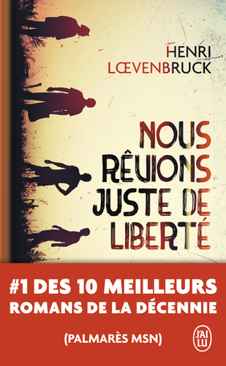

+++
title = "Libre sur la route, captif face à la panne"
date = 2026-10-27
draft = false
[taxonomies]
tags = ["onewheel", "FOSS", "hardware", "fécalismeg"]
[extra]
toc = false
display_published = true 
author = "Cætera"
+++

Comme beaucoup, j’aimais bien les sports d’hiver —ça fait presque 10 ans que je n’en ai pas fait.
La raison ? La météo imprévisible, la raréfaction de la neige et la volonté de ne pas participer à une activité trop polluante pour les montagnes.

Mais si… si retrouver des sensations similaires était possible, sans _trop_ de pollution, au quotidien ? Et si aller au travail pouvait passer d’une corvée à une aventure de glisse ? Et s’il était possible de surfer sur les routes ?

Ces questions ont trouvé une réponse il y a une dizaine d’années, sous la forme du [onewheel]. Une planche étrange, avec une grosse roue au milieu et deux emplacements pour les pieds.

C’est donc en 2023, en parallèle de [mon voyage ergonomique][ergo], que je me lance à la recherche d’une planche d’occasion. D’_occasion_ parce que, d’une part, c’est très cher — compter plus de 3 000 € neuf —, mais aussi parce que l’entreprise derrière ces bolides — Future Motion — a déjà mauvaise presse. Je ne suis pas sûr de vouloir lui donner mon argent.

Après quelques recherches, le modèle « XR » semble être la meilleure option pour commencer. J’en trouve une à 800 € tout de même, à l’époque ; je rentre chez moi avec les poches légères et la question : « Comment tenir sur cet engin ? » Une chose est sûre : ma relation à la route et aux trajets, de façon générale, va totalement changer.

Le plaisir du détour et des sentiers non battus
---------------------------------

C’est plus simple que ça en a l’air et, très vite, je m’adapte. Je le prends ~~en main~~ _en pied_ rapidement. Au final, une vingtaine de minutes suffisent pour arriver à se diriger et à maîtriser sa vitesse. Puis, c’est de plus en plus fluide : à moi le hors-piste sur le sable et ses chutes permissives, à moi les virées à la boulangerie qui deviennent un jeu, à moi bientôt la ville, que je n’ose pas encore rejoindre de peur de me confronter aux voitures.

Petit à petit, la planche devient une extension de mes jambes, de mes hanches, de mes épaules. Je surfe sur la route, _je suis la liberté_. J’appuie un peu sur mes orteils ou sur mes talons et, _magie_, la planche tourne et se meut de façon fluide.

Un trajet banal devient une petite escapade. Un détour devient une excellente idée. Et sortir sans destination précise devient un programme tout à fait satisfaisant. « Je vais faire le tour du village », me surprends-je à dire en rentrant du travail.

Pour moi, le Onewheel, c’est ça : une petite bulle de liberté, accessible dès qu’on pose les pieds dessus. J’en viens _presque_ à bouder mon vélo.

Il faut reconnaître que c’est plus compact, que ça se sort bien plus facilement et que ça passe sous le siège. Que ce soit dans le train, dans les bus ou dans les cars, il se glisse facilement partout. Seuls les avions nous sont interdits, du fait d’une batterie considérée comme trop grosse. Je ne prends pas souvent l’avion, mais les rares fois où j’ai dû m’y résoudre, ma planche m’a rapidement manqué.

La pluie a refroidi l’ambiance
----

Je vous avais dit que je n’aimais pas Paris ? En même temps, qui aime Paris ? Ceux qui n’y ont pas été exilés pendant sept ans et ceux qui n’y ont pas emmené leur planche, flambant d’occasion.

Bref, je suis allé à Paris avec ma planche et, en banlieue, je me suis retrouvé sous le feu d’une averse carabinée. L’eau montait sur la route et je me suis dépêché de trouver la gare RER la plus proche pour ne pas abîmer ma planche. Trop tard.

Bien qu’elles soient vendues avec des publicités les montrant près de la mer et qu’elles soient présentées comme _water resistant_, il n’en est rien. Une fois sorti du train, impossible de _rider_. La planche se met très vite en sécurité et refuse de redémarrer.

  
Détails sur la panne

Je démonte la planche et le diagnostic est clair : le BMS — le contrôleur de batterie — est à changer. Dans un premier temps, je suis rassuré : c’est le genre de composant qui coûte quelques dizaines d’euros tout au plus… sauf quand la conception vient de Future Motion.

Là, les choses ont été conçues pour que ce ne soit pas réparable. Le BMS communique avec le contrôleur, qui s’assure qu’un numéro de série spécifique lui est relié. La plaie. Pour changer le BMS, il faut donc également changer le contrôleur, et donc une grande partie de l’électronique.

_In fine_, ce sont tous les composants électroniques qu’il faut changer, sans compter l’aller-retour obligatoire aux États-Unis et la main-d’œuvre californienne. Cela se répercute sur le prix de la réparation : plus de 1 500 €, de mémoire — en tout cas, suffisamment pour que l’option évidente soit de racheter une nouvelle planche.

De là à dire que c’est du [fécalisme], il y a un pas que je franchis timidement. Faire payer le prix fort pour les pièces de rechange pourrait se comprendre ; s’appuyer sur des partenaires locaux pour les réparations semblerait aussi évident. Mais ici, il n’en est rien. Future Motion préfère garder les utilisateurs captifs, impuissants, sans possibilité d’intervenir sur le matériel.

J’avais donc le choix entre racheter une planche d’occasion après un mois d’attente ou payer plus cher pour faire réparer la mienne. Je me suis mis à la recherche d’une troisième voie.

Pour un objet qui m’apportait autant de liberté, le contraste était assez savoureux. Enfin, sur le moment, pas tellement.

Réparer la planche, reprendre la main
---

Je me suis tourné vers des composants alternatifs pour réparer moi-même la planche. Il fallait d’abord comprendre davantage ce qu’il y avait dedans pour reprendre le contrôle de son fonctionnement.

Mode ingénieur _on_.

J’ai d’abord étudié l’ensemble des composants nécessaires à la fabrication d’une planche. Dans l’idée, un BMS et un contrôleur suffisaient. Mais il fallait ensuite changer toutes les interfaces entre les composants et les capteurs : un travail conséquent que je n’étais pas sûr de pouvoir me permettre.

Puis, coup de chance, un kit de mise à niveau [XR-V] est sorti. Ça semblait louche : il fallait payer en cryptomonnaie pour y avoir accès. Soit, je tente ma chance.

Ça fonctionne. Ouf, je suis reparti — et avec quel changement ! J’ai bien plus de couple disponible, donc plus de facilité à monter les marches, à prendre des pentes plus raides et à rouler hors piste sur des chemins pleins de nids-de-poule.

Un plaisir décuplé, en somme, avec l’assurance d’avoir prolongé la vie de ma planche, puisque je ne suis plus dépendant d’un constructeur défaillant.

La modification a tout de même un petit bémol : la batterie se vide plus vite lorsque la planche est éteinte. Je suis parti un an à l’étranger en laissant la planche au placard. À mon retour, elle était extrêmement déchargée — les cellules au lithium étaient à 2,3 V ! C’était dangereux de tester la planche ; je l’ai fait progressivement, avec toutes les protections et précautions nécessaires. Mais j’ai toujours un doute sur l’impact de cette décharge sur la batterie.

Après cet incident et plus de 1 500 km parcourus depuis, la batterie est moins _punchy_. Est-ce dû à cette décharge ou aux composants ? Je ne saurais le dire. Le fait est qu’après plus de 3 500 km, 175 cycles et cinq ans de vie, cette usure me semble un peu prématurée.

Un nouveau pneu, une nouvelle planche
---

Dernière découverte en date : le changement de pneu.

L’avantage d’un pneu lisse comme celui que j’avais, c’est qu’on peut l’user au maximum sans constater de diminution des performances. Mais avec une seule roue, la perspective d’une crevaison me faisait peur. Après avoir usé les témoins de marquage jusqu’au bout, il était temps de le changer.

Je m’attendais à une différence. Pas tant que ça.

J’étais parti sur un Enduro, mais il était en rupture de stock depuis plus de deux mois. Je me suis rabattu sur un [Thunder] qui était alors en promotion : 80 $ avec livraison mondiale gratuite.

Avec le Thunder, la planche est un peu moins stable, mais beaucoup plus maniable. C’est normal : la zone de contact avec le sol est plus réduite, en raison du profil moins carré du pneu, davantage en forme de « U ».

Avec ce pneu, la planche s’engage plus facilement dans les virages, répond davantage et donne envie de jouer avec chaque courbe. Il faut retrouver ses repères : les petites erreurs pardonnent moins. Je me suis fait peur plus d’une fois au début, mais le plaisir est bien là.

Rétrospectivement, j’ai l’impression d’avoir couru avec des bottes pendant des années, puis d’avoir enfin enfilé des chaussures adaptées.

J’avais à peine 30 ans et je ne rêvais que de liberté
---

Trois ans plus tard, malgré la panne, les réparations et une batterie qui montre son âge, le plaisir est toujours là. Cette planche m’a fait découvrir une façon de me déplacer, puis le plaisir de comprendre et de réparer.

Je ne regrette qu’une chose : la politique de l’entreprise à l’origine de cet objet. Posséder un objet, ce n’est pas seulement l’acheter ; c’est aussi être capable de le comprendre, de le maintenir en état de fonctionnement, voire de le modifier. C’est un aspect que les communautés du logiciel libre ont bien compris depuis longtemps. Il est plus que temps que cette idée infuse _aussi_ dans le matériel.

[onewheel]:(https://rideonexperience.com/)
[Thunder]: https://fungineers.us/products/thunder-tire
[fécalisme]:@/blog/le-fecalisme/index.md
[XR-V]:https://floatwheel.co/index.php?route=product/product&product_id=9930
[ergo]:@/blog/voyage-ergonomique-1